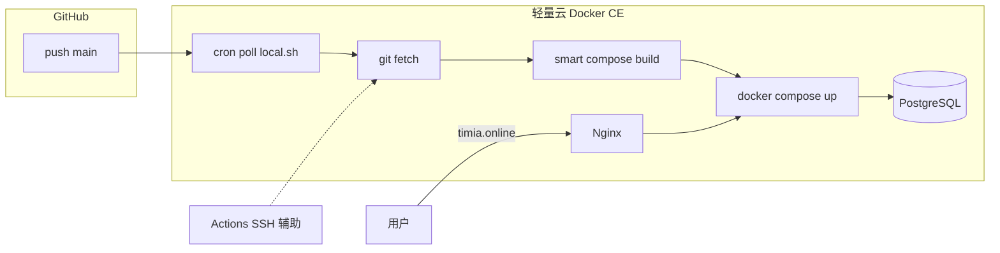

# Timia 生产部署指南（轻量云 · 无 TCR）

生产域名：**https://timia.online**

生产环境仅使用 **腾讯云轻量应用服务器（Docker CE 镜像）**：在服务器上 `git pull`，用 **Docker Compose 本地构建** 并启动，**不使用** 容器镜像服务（TCR/CCR）。

自动部署以服务器轮询为主，GitHub Actions SSH 为辅：

1. **轮询部署（主路径，推荐）**：服务器 cron 每 3 分钟 `git fetch`，`main` 有新提交则执行 `local.sh`（`install-cron` / `poll`）。**不需要** GitHub 连 SSH 进来。
2. **GitHub Actions SSH（辅助）**：仅当 push 命中服务端 **paths** 时，由 Actions SSH 执行 `local.sh`。从 GitHub 连国内轻量云常被 **`connection reset by peer`** 重置，失败不代表轮询没在发版。

**paths 过滤**（`.github/workflows/deploy.yml`）：只有 `codes/core-service`、`codes/file-service`、`codes/notification-service`、`codes/web`、`codes/mcp-server`、`deploy/nginx.conf`、`deploy/local.sh`、`deploy/_common.sh`、`deploy/dc.sh`、`docker-compose.prod.yml` 的变更才启动 **Deploy to Lighthouse**。`codes/mobile/**` 与 `docs/**` 不触发这条 workflow（iOS 仍走独立的 TestFlight workflow）。手动运行用 **workflow_dispatch**，可选 `deploy_mode`。

## 架构



| 组件 | 说明 |
|------|------|
| `core-service` / `file-service` / `notification-service` / `web` / `mcp-server` | 在轻量云上 `docker compose build`（见 `codes/*/Dockerfile`） |
| `db` | 官方 `postgres:16` 镜像，数据卷持久化 |
| `minio` | 私有对象存储，仅 docker 内网，nginx 不暴露 |
| `nginx` | 反代 + HTTPS（证书在宿主机 `/etc/letsencrypt`）；对外暴露 `/mcp` 与 `/mcp-health` |

| 文件 | 用途 |
|------|------|
| `.github/workflows/deploy.yml` | 辅助：push `main` 且命中服务端 paths 时 SSH 执行 `local.sh`；`workflow_dispatch` 可选手动 `deploy_mode` |
| `docker-compose.prod.yml` | 生产编排 |
| `deploy/local.sh` | 服务器部署；子命令 `bootstrap` / `poll` / `install-cron` |
| `deploy/dc.sh` | 带 `.env.prod` 的 compose 命令 |
| `deploy/remote.sh` | 本机构建并上传；默认 **smart**：只打包有改动的服务，构建/上传可并行 |
| `deploy/nginx.conf` | `timia.online` HTTPS（compose 挂载此路径） |
| `.env.prod.example` | 服务器 `.env.prod` 模板 |

---

## 一、一次性准备

### 1. 轻量应用服务器

- **应用镜像**：**Docker CE**（已预装 Docker）
- **规格**：建议 **2GB 内存及以上**（构建 Next.js 较吃内存）
- 记录 **公网 IP** → 后续 `SSH_HOST`、DNS

**防火墙**（轻量云控制台 → 实例 → **防火墙**）放通：

| 协议 | 端口 |
|------|------|
| TCP | 22 |
| TCP | 80 |
| TCP | 443 |

**SSH**：控制台查看登录用户（多为 `root`），配置 **SSH 密钥**（GitHub Actions 需密钥登录，不建议仅密码）。

登录后确认：

```bash
docker --version
docker compose version
```

**国内轻量云建议立刻配置镜像加速**（避免 build 时 `0B / xxMB` 卡住）：见下文「拉取基础镜像不动」一节，手动配置 `/etc/docker/daemon.json`。

### 2. DNS

`timia.online` **A 记录** → 轻量云公网 IP。

### 3. 首次初始化（`local.sh bootstrap`）

SSH 登录轻量云后，任选一种方式执行。

**方式 A — 从本机上传（私有仓库推荐）**

在本机项目根目录：

```bash
scp deploy/local.sh root@<轻量云IP>:/tmp/local.sh
ssh root@<轻量云IP> 'chmod +x /tmp/local.sh && /tmp/local.sh bootstrap git@github.com:<你的用户名>/timia.git /opt/timia'
```

**方式 B — 公开仓库 clone 后执行**

```bash
git clone https://github.com/<你的用户名>/timia.git /opt/timia
cd /opt/timia
bash deploy/local.sh bootstrap git@github.com:<你的用户名>/timia.git /opt/timia
```

**私有仓库**：先在服务器生成 Deploy Key 并加到 GitHub **Settings → Deploy keys**：

```bash
ssh-keygen -t ed25519 -C "timia-lighthouse" -f ~/.ssh/id_ed25519 -N ""
cat ~/.ssh/id_ed25519.pub
```

`local.sh bootstrap` 会：

1. 将仓库 clone 到 `/opt/timia`（默认分支 `main`）
2. 若不存在则复制 `.env.prod.example` → `.env.prod`
3. 打印后续步骤（改密钥、证书、首次 deploy）

已初始化过再次执行时，只会 `git pull` 更新代码；密钥在 **`/etc/timia/.env.prod`**，不会被覆盖。

**方式 C — 手动 clone**（不用脚本时）

```bash
sudo mkdir -p /opt/timia && sudo chown "$USER:$USER" /opt/timia
git clone https://github.com/<你的用户名>/timia.git /opt/timia
cp /opt/timia/.env.prod.example /opt/timia/.env.prod
```

### 4. 配置生产环境变量（`/etc/timia/.env.prod`）

| 环境 | 配置文件 | 位置 |
|------|----------|------|
| 本地开发 | `codes/core-service/.env`、`codes/web/.env.local` | 见 `.env.example` |
| **生产轻量云** | **`.env.prod`** | **`/etc/timia/.env.prod`**（在 git 仓库外） |

**不要把密钥放在 `/opt/timia/.env.prod`**。若该文件曾被 git 跟踪，`git pull` 可能覆盖、删除或还原成模板。应使用仓库外的 `/etc/timia/.env.prod`。

```bash
sudo mkdir -p /etc/timia
sudo cp /opt/timia/.env.prod.example /etc/timia/.env.prod
sudo nano /etc/timia/.env.prod
sudo chmod 600 /etc/timia/.env.prod
```

若你已有 `/opt/timia/.env.prod`，迁出仓库并修复 git：

```bash
cd /opt/timia
git pull
sudo mv .env.prod /etc/timia/.env.prod
sudo chmod 600 /etc/timia/.env.prod
```

生产 **不需要** 在 `codes/core-service/`、`codes/web/` 下创建 `.env`。

必填项：

| 变量 | 说明 |
|------|------|
| `POSTGRES_PASSWORD` | `openssl rand -hex 24` |
| `JWT_SECRET` | `openssl rand -hex 32` |
| `DATABASE_URL` | 密码与上一致，主机必须是 `db` |
| `CORS_ORIGINS` | `https://timia.online` |
| `NEXT_PUBLIC_API_BASE_URL` | `https://timia.online/core-service` |
| `NEXT_PUBLIC_FILE_API_BASE_URL` | `https://timia.online/file-service` |
| `NEXT_PUBLIC_NOTIFICATION_API_BASE_URL` | `https://timia.online/notification-service` |
| `FILE_INTERNAL_TOKEN` | core 调 file-service `/internal`；与 file-service 相同 |
| `NOTIFICATION_INTERNAL_TOKEN` | core 调 notification-service `POST /v1/notifications`；与 notification-service 相同 |
| `NOTIFICATION_SERVICE_BASE` | 生产为 `http://notification-service:8001`（compose 也会覆盖） |
| `NOTIFICATION_DISPATCH_INTERVAL_SECONDS` | 通知服务扫描到期 `delay` / `scheduled` 的间隔，默认 `30`。设为 `0` 关闭进程内循环，再手动执行 `python -m app.jobs.dispatch_scheduled` |
| `MINIO_ROOT_PASSWORD` | MinIO 根密码；`MEDIA_S3_SECRET_KEY` 须与此一致 |

APNs 与运营发送（可选。留空则收件箱照常，推送保持 `pending`，`POST /internal/push/dispatch` 返回 `push_not_configured`，不把通知接口打成 500）：

| 变量 | 说明 |
|------|------|
| `APNS_KEY_ID` | Apple Developer 里 APNs Auth Key 的 Key ID |
| `APNS_TEAM_ID` | Apple Developer Team ID |
| `APNS_BUNDLE_ID` | `online.timia.ios` |
| `APNS_KEY_P8` | `.p8` 全文。可写成一行，把换行换成 `\n`，或把 PEM 做 base64。不要提交到 git |
| `APNS_USE_SANDBOX` | `true` 走 `api.sandbox.push.apple.com`（仅 sandbox token 的服务端测试）。当前 iOS 客户端是 production，TestFlight / App Store 用 `false` |

真机要弹出系统通知，还需要：Apple 账号开通 Push Notifications，并下载 APNs Auth Key（`.p8`，不是证书密码）。iOS 的 `aps-environment` 是 `production`，`APNsDeviceToken.environment` 为 `production`（TestFlight / App Store，没有 Debug/Release 分叉）。服务器设 `APNS_USE_SANDBOX=false`。场景的「移动推送」要打开（`push_enabled`）。没有密钥时 App 仍可注册 token，通知只出现在收件箱。管理端「发送通知」不走场景推送开关，只写入收件箱。

示例 `DATABASE_URL`：

```text
postgresql+psycopg://timia:<POSTGRES_PASSWORD>@db:5432/timia
```

### 5. HTTPS 证书（首次）

Nginx 需要 `/etc/letsencrypt/live/timia.online/`。首次申请前先停 nginx：

```bash
cd /opt/timia
./deploy/dc.sh stop nginx 2>/dev/null || true

sudo apt-get update && sudo apt-get install -y certbot
sudo certbot certonly --standalone -d timia.online
```

续期（示例）：

```bash
echo "0 3 * * * root certbot renew --quiet && docker compose -f /opt/timia/docker-compose.prod.yml exec nginx nginx -s reload" | sudo tee /etc/cron.d/timia-certbot
```

### 6. 首次手动启动（验证环境）

```bash
cd /opt/timia
chmod +x deploy/local.sh
export SKIP_GIT_PULL=1   # 代码已在本地，跳过 pull
./deploy/local.sh
```

检查：

```bash
curl -fsS https://timia.online/core-service/health
```

### 7. 自动部署（推荐：轮询，无需 GitHub SSH）

在轻量云执行一次（push 后约 **3 分钟内**自动 `git pull` + 构建）：

```bash
cd /opt/timia
git pull
sudo bash deploy/local.sh install-cron
```

查看是否在部署：

```bash
tail -f /var/log/timia-deploy-poll.log
```

手动触发检查（不等待 cron）：

```bash
cd /opt/timia
bash deploy/local.sh poll
```

**原理**：`local.sh poll` 比较 `HEAD` 与 `origin/main`，有更新才跑部署；用文件锁避免重复构建。

启用轮询后，即使 Actions SSH 失败，**推送到 `main` 仍会自动上线**。

### 8. GitHub Actions Secrets（可选 SSH 部署）

仓库 **Settings → Secrets and variables → Actions**：

| Secret | 说明 |
|--------|------|
| `SSH_HOST` | 轻量云公网 IP |
| `SSH_USER` | 如 `root` |
| `SSH_PRIVATE_KEY` | 对应实例的私钥全文（PEM） |
| `SSH_PORT` | 可选；不填则默认 22 |
| `DEPLOY_PATH` | 仓库路径，如 `/opt/timia` |

**不需要** `TCR_*` 等镜像仓库凭据。

---

## 二、日常部署（自动）

### 部署模式（缩短耗时）

默认 **`DEPLOY_MODE=smart`**（`deploy/local.sh` 与轮询都是这个默认值）：`git fetch` 后对照上一版 HEAD，按 `deploy/_common.sh` 的路径映射**只构建有改动的镜像**。只改 `codes/mobile/**` 或纯文档时**不重建镜像**（清单为空时只 `compose up` 确认栈在跑），不会因为 iOS 或文档去跑长时间的 web 构建。

| 变更路径 | smart 目标 |
|----------|------------|
| `codes/core-service/**` | `core-service` |
| `codes/file-service/**` | `file-service` |
| `codes/notification-service/**` | `notification-service` |
| `codes/web/**` | `web` |
| `codes/mcp-server/**` | `mcp-server` |
| `deploy/nginx.conf` | `nginx`（重建容器，不 build 业务镜像） |
| `docker-compose.prod.yml` | `core-service`、`file-service`、`notification-service`、`web`、`mcp-server` 与 `nginx` |
| `codes/mobile/**`、`docs/**` 及其它未映射路径 | 不 build 镜像 |

| 命令 | 适用 |
|------|------|
| `bash deploy/local.sh` | 日常（默认 smart；只 build 清单里的服务，**并行**） |
| `DEPLOY_MODE=quick bash deploy/local.sh` | 只重启，或镜像已是最新（不 build） |
| `DEPLOY_MODE=full bash deploy/local.sh` | 依赖升级、构建异常、首次部署（五个应用服务 + nginx） |
| `DEPLOY_MODE=core-service bash deploy/local.sh` | 只构建 core-service |
| `DEPLOY_MODE=file-service bash deploy/local.sh` | 只构建 file-service |
| `DEPLOY_MODE=notification-service bash deploy/local.sh` | 只构建 notification-service |
| `DEPLOY_MODE=web bash deploy/local.sh` | 只构建 web |
| `DEPLOY_MODE=mcp-server bash deploy/local.sh` | 只构建 mcp-server |

### GitHub Actions paths（只约束 SSH 辅助）

`.github/workflows/deploy.yml` 的 `push` **paths** 与上表里的服务端文件对齐，并额外包含部署脚本（改脚本可以走一遍 SSH；smart 仍只按上表决定是否 build）：

- `codes/core-service/**`
- `codes/file-service/**`
- `codes/notification-service/**`
- `codes/web/**`
- `codes/mcp-server/**`
- `deploy/nginx.conf`
- `deploy/local.sh`
- `deploy/_common.sh`
- `deploy/dc.sh`
- `docker-compose.prod.yml`

不包含 `codes/mobile/**`、`docs/**`。因此 **只改 iOS 的 push 不会启动 Deploy to Lighthouse**（TestFlight workflow 有自己的 paths）。`workflow_dispatch` 不受 paths 限制。可选输入 `deploy_mode`：`smart` | `full` | `core-service` | `file-service` | `notification-service` | `web` | `mcp-server`，经 SSH 设为服务器上的 `DEPLOY_MODE`。普通 push 没有该输入，固定 `smart`。

本机 `deploy/remote.sh`（轻量云 SSH 上传镜像）同样默认 **smart**：

```bash
bash deploy/remote.sh plan          # 对照服务器 HEAD，列出要部署的服务
bash deploy/remote.sh               # plan → 并行 build → 按服务分别打包上传
PACK_SERVICES=web bash deploy/remote.sh   # 强制只发 web
PACK_SERVICES=all bash deploy/remote.sh   # 全量
DEPLOY_BASE=<sha> bash deploy/remote.sh   # 指定对比基线（不探服务器）
PARALLEL_UPLOAD=0 bash deploy/remote.sh upload  # 串行上传（SSH 不稳时）
```

未改动的服务**不会**打进包、也不会上传。

`git fetch + reset` 已替代 `git pull`，一般更快。

推送到 **`main`** 后：

- **已安装轮询**（主路径）：服务器约 3 分钟内自动部署。看 `tail -f /var/log/timia-deploy-poll.log`。日志里的 `Deploy checklist` 列出本次要 build 的服务；只有文档或 iOS 时应看到 `(none) — compose up only`。
- **Actions SSH**（辅助）：仅当上一节的 paths 命中时，**Actions → Deploy to Lighthouse** 才会出现。GitHub 连国内轻量云常 `connection reset by peer`，失败不代表轮询没在发版。

服务器上 `deploy/local.sh` 默认流程：

1. `git fetch` 并切到 `origin/main`
2. smart 对照 diff，并行 `docker compose build` 清单中的应用镜像（构建日志在 `/tmp/timia-deploy-logs/build-<service>.log`）
3. `up -d` 重建这些服务；构建了应用镜像，或 nginx/compose 在清单里时，重建 nginx，并保证整栈 `up -d`

### 验证

```bash
tail -f /var/log/timia-deploy-poll.log
curl -fsS https://timia.online/core-service/health
```

只改 iOS 或文档后：该次 push 的 Actions 里不应出现 **Deploy to Lighthouse**；轮询日志不应出现对应服务的 `docker build`。MCP 健康检查（若本次动了 mcp-server）：`curl -fsS https://timia.online/mcp-health`。

---

## 三、手动部署 / 回滚

### 防止 SSH 断开导致部署中断

`local.sh` 会在服务器上执行 `docker compose build`（尤其是 **web/Next.js**），可能耗时 **10～30+ 分钟**。SSH 断开时，前台进程通常会收到 SIGHUP 并被终止。

**推荐：用 `tmux` 或 `screen` 在后台跑**

```bash
ssh root@<轻量云IP>
cd /opt/timia

# 方式 1：tmux（推荐）
tmux new -s timia-deploy
./deploy/local.sh
# 断开会话：Ctrl+b 然后按 d
# 重新连上后恢复：tmux attach -t timia-deploy
```

```bash
# 方式 2：nohup + 日志文件
cd /opt/timia
nohup ./deploy/local.sh > /tmp/timia-deploy.log 2>&1 &
tail -f /tmp/timia-deploy.log
```

未安装 tmux 时：`apt-get install -y tmux`

### 执行部署

SSH 登录轻量云：

```bash
cd /opt/timia
./deploy/local.sh
```

### SSH 断开后如何查看进度

重新 SSH 登录后，在 `/opt/timia` 依次检查：

**1. 部署脚本是否还在跑**

```bash
pgrep -af "local.sh|docker compose"
```

有输出说明仍在 build/up；没有输出说明已结束（成功或失败）。

**2. 若用了 nohup，看日志**

```bash
tail -f /tmp/timia-deploy.log
```

**3. Docker 是否仍在构建**

```bash
docker ps                    # 运行中的容器
docker ps -a --last 5      # 最近退出的容器（含 build 中间层）
docker images | head -20   # 是否已有新构建的 core/file/web/mcp 镜像
```

**4. Compose 服务状态**

```bash
cd /opt/timia
./deploy/dc.sh ps
```

> 不要省略 `--env-file`：请用 `./deploy/dc.sh`，不要直接 `docker compose -f docker-compose.prod.yml ps`，否则会出现 `POSTGRES_USER variable is not set` 警告且服务起不来。

| 状态 | 含义 |
|------|------|
| `core-service`、`file-service`、`notification-service`、`web`、`mcp-server`、`db`、`nginx` 均为 `Up` | 部署很可能已成功 |
| 缺少上述应用服务或状态 `Exit` | build 未完成或 `up` 失败 |
| 仅有 `db` 在跑 | 可能卡在 build 或脚本已退出 |

**5. 查看服务日志（定位失败）**

```bash
./deploy/dc.sh logs --tail=100 core-service
./deploy/dc.sh logs --tail=100 file-service
./deploy/dc.sh logs --tail=100 web
./deploy/dc.sh logs --tail=100 mcp-server
```

**6. 验证是否已上线**

```bash
curl -fsS https://timia.online/core-service/health
```

**7. 若脚本已死、状态不明 — 安全重跑**

```bash
cd /opt/timia
tmux new -s timia-deploy
export SKIP_GIT_PULL=1    # 若代码已是最新可跳过 pull
./deploy/local.sh
```

> GitHub Actions 触发的部署同样在服务器上执行 `local.sh`；可在仓库 **Actions** 页查看该次 workflow 是否成功，不必保持本地 SSH 不断开。

回滚到指定 commit：

```bash
cd /opt/timia
git fetch origin
git checkout <commit-sha>
export SKIP_GIT_PULL=1
./deploy/local.sh
```

确认无误后，如需让 `main` 与此一致，再在 GitHub 上 revert 或合并修复提交。

---

## 四、运维

生产环境统一用包装脚本（自动加载 `.env.prod`）：

```bash
cd /opt/timia
./deploy/dc.sh ps
./deploy/dc.sh logs -f --tail=200 core-service
./deploy/dc.sh logs -f --tail=200 file-service
./deploy/dc.sh logs -f --tail=200 web
./deploy/dc.sh logs -f --tail=200 mcp-server
./deploy/dc.sh logs -f --tail=200 nginx
./deploy/dc.sh logs -f --tail=200 db
```

仅重建某一服务（示例为 web；core-service / file-service / mcp-server 同样替换服务名）：

```bash
./deploy/dc.sh build web
./deploy/dc.sh up -d web
```

数据库备份：

```bash
./deploy/dc.sh exec -T db pg_dump -U timia timia > "backup_$(date +%F).sql"
```

---

## 五、排障

### `local.sh` 卡住、长时间无输出

默认 **smart** 会：**git fetch → 按变更清单并行 build 有改动的服务 → up**。多数「假死」是 **web 的 `npm ci` / `next build`**（轻量云 2GB 内存可能要 **20～40 分钟**）。并行构建的详细输出写在 `/tmp/timia-deploy-logs/build-<service>.log`，主日志在构建结束前可能只有 `Building N service(s) in parallel ...`。

**先确认卡在哪一步**（另开一个 SSH 窗口）：

```bash
pgrep -af "local.sh|docker|npm|node"
tail -20 /var/log/timia-deploy-poll.log   # cron 轮询
tail -20 /tmp/timia-deploy.log            # 若用 nohup 部署
tail -20 /tmp/timia-deploy-logs/build-web.log
```

| 日志 | 实际在做什么 |
|------|----------------|
| `Step 1: git fetch & sync` | 拉代码；私有库未配 Deploy Key 会失败 |
| `Deploy checklist:` 后列出服务名 | smart 判定要 build / 重建的服务 |
| `Deploy checklist: (none)` | 本次 diff 不映射到镜像（例如只改了 iOS 或文档） |
| `Building N service(s) in parallel` | 正在 build；看 `/tmp/timia-deploy-logs/build-<service>.log` |
| `docker build web` 长时间无新行 | 构建前端（最慢，属正常） |
| `Recreating` / `Ensuring stack is up` | 启动或重建容器 |

**建议**：用 `tmux` 跑部署，并 `git pull` 拿到带分步日志的 `local.sh`：

```bash
cd /opt/timia && git pull
tmux new -s timia-deploy
export SKIP_GIT_PULL=1   # 代码已最新时可跳过
./deploy/local.sh
```

**单独重试某一阶段**：

```bash
cd /opt/timia
./deploy/dc.sh build --progress=plain core-service
./deploy/dc.sh build --progress=plain file-service
./deploy/dc.sh build --progress=plain web   # 最耗时
./deploy/dc.sh build --progress=plain mcp-server
./deploy/dc.sh up -d
```

**git 阶段卡住**：检查 Deploy Key，`ssh -T git@github.com` 应成功；或临时 `export SKIP_GIT_PULL=1` 跳过。

**内存不足**（build 极慢或进程被 kill）：

```bash
free -h
dmesg | tail -20 | grep -i oom
```

可添加 2GB swap 或升级套餐后再 build。

### 拉取基础镜像 `0B / 25MB` 不动（Docker Hub 很慢）

构建日志里出现类似：

```text
=> => sha256:dc53ac... 0B / 25.15MB
```

说明正在从 **Docker Hub** 下载基础镜像层（如 `node:20-alpine`、`python:3.12-slim`），国内轻量云访问 Docker Hub 经常极慢或像卡住。**不是** 你的业务代码问题。

**处理：配置镜像加速（一次性）**

在轻量云 SSH 执行（需 root），手动写入 `/etc/docker/daemon.json` 后 `sudo systemctl restart docker`：

```json
{
  "registry-mirrors": [
    "https://mirror.ccs.tencentyun.com",
    "https://docker.m.daocloud.io"
  ]
}
```

**验证能否拉镜像**（应有进度、能完成）：

```bash
docker pull node:20-alpine
docker pull python:3.12-slim
docker pull postgres:16
docker pull nginx:alpine
```

通过后再部署：

```bash
cd /opt/timia
tmux new -s timia-deploy
export SKIP_GIT_PULL=1
./deploy/local.sh
```

若仍卡在 `0B`：检查轻量云 **带宽/流量** 是否用尽，或换时段重试；必要时在控制台重启实例后再 `docker pull`。

| 现象 | 处理 |
|------|------|
| `sha256... 0B / xx MB` 无进度 | 配置 **Docker 镜像加速**，见上文；先 `docker pull node:20-alpine` 测试 |
| `local.sh` 无输出像卡死 | 多为 **web build** 或 **拉基础镜像**；用 `tmux`、`--progress=plain`、见上文 |
| Actions `connection reset by peer` | **启用轮询**：`sudo bash deploy/local.sh install-cron`（见「一、7」）；或检查防火墙 22 对 `0.0.0.0/0` 放通、Secrets 中 IP/密钥正确、本机 `ssh -i key user@IP` 能否登录 |
| Actions SSH 失败 | 检查 `SSH_*`、`DEPLOY_PATH`、防火墙 22、密钥；或改用轮询部署 |
| Actions `chmod: Operation not permitted` | `SSH_USER` 对 `/opt/timia` 无写权限时用 `bash deploy/local.sh`（已修复）；或把目录属主改为该用户 |
| `No .git` | 未 clone 仓库，按「一、3」操作 |
| `git pull` 失败（私有库） | 配置 Deploy Key 或检查 `git remote` |
| `build` 很慢或 OOM | 用默认 **`smart`** 或 `DEPLOY_MODE=quick`；只重建一个服务时用 `DEPLOY_MODE=core-service`（或 `file-service` / `notification-service` / `web` / `mcp-server`）；升级内存 |
| 每次部署都要 build web | 确认用默认 `smart`；全量才用 `DEPLOY_MODE=full`。只改 iOS/文档不应 build web |
| Actions 在只改 iOS 时仍启动 Deploy | 确认 `main` 上的 `deploy.yml` 已带 **paths**，且该 push 没有同时改服务端路径 |
| CORS 错误 | `.env.prod` 中 `CORS_ORIGINS=https://timia.online` |
| 前端 API 地址错误 | 修改 `NEXT_PUBLIC_API_BASE_URL` 后必须 **`build web`** 再 `up` |
| 迁移失败 | `docker compose logs core-service`（启动时自动 `alembic upgrade head`） |
| HTTPS 失败 | 证书路径是否为 `/etc/letsencrypt/live/timia.online/` |
| 外网无法访问 | 轻量云 **防火墙** 放通 80/443 |
| SSH 断开不知道进度 | 用 `tmux`/`nohup` 部署；重连后 `pgrep`、`compose ps`、见上文「SSH 断开后如何查看进度」 |
| `POSTGRES_* variable is not set` | 缺少 `/etc/timia/.env.prod`；用 `./deploy/dc.sh`，勿在 `codes/core-service` 下建 `.env` |
| `git pull` 覆盖 `.env.prod` | 密钥改放到 **`/etc/timia/.env.prod`**，运行 `bash deploy/local.sh bootstrap` 或手动 `git rm --cached .env.prod` |
| `ps` 无任何容器 | 尚未成功执行 `./deploy/local.sh`，或 build 失败；`./deploy/dc.sh logs core-service` 排查 |

---

## 六、与「TCR + 拉镜像」方案的区别

| 项目 | 本方案（仅轻量云） | TCR 方案 |
|------|-------------------|----------|
| 构建位置 | 轻量云本机 | GitHub Actions |
| 镜像仓库 | 不需要 | 需要 TCR |
| 部署速度 | 首次/全量 build 较慢 | pull 较快 |
| 适用 | 单机、简单、无额外服务 | 多机、大镜像、构建与运行分离 |

---

## 安全说明

- 生产密钥保存在 **`/etc/timia/.env.prod`**，勿放在 git 仓库目录内，勿提交 Git。
- 若曾泄露数据库或 JWT 密钥，请立即轮换并重启 `core-service`/`db`（改密码需同步 `DATABASE_URL`）。
- Agent PAT（`tm_pat_…`）仅用于 MCP/API 调用，勿写入 compose 进程环境；撤销后立即失效。

---

## MCP 远程（Streamable HTTP）

生产对外地址：

| 路径 | 说明 |
|------|------|
| `https://timia.online/mcp` | MCP Streamable HTTP（必须带 `Authorization: Bearer tm_pat_…`） |
| `https://timia.online/mcp-health` | 健康检查（无需鉴权） |

容器内：`mcp-server:8100`，`TIMIA_API_BASE=http://core-service:8000`，`TIMIA_MCP_TRANSPORT=http`。**不要**设置进程级 `TIMIA_PAT`。

健康检查：

```bash
curl -fsS https://timia.online/mcp-health
# {"ok": true, "transport": "http"}
```

创建生产 PAT（需 Web JWT）：

```bash
curl -s -X POST https://timia.online/core-service/auth/agent-tokens \
  -H "Authorization: Bearer <web-jwt>" \
  -H "Content-Type: application/json" \
  -d '{"name":"cursor-prod","scopes":["profile:read","workspace:read","schedule:read"]}'
```

回滚：`docker compose stop mcp-server`（或从 nginx 去掉 `/mcp` location 后 reload）。仅需重发 MCP 时：`DEPLOY_MODE=mcp-server bash deploy/local.sh`。

Cursor 配置见 `codes/mcp-server/README.md`。
